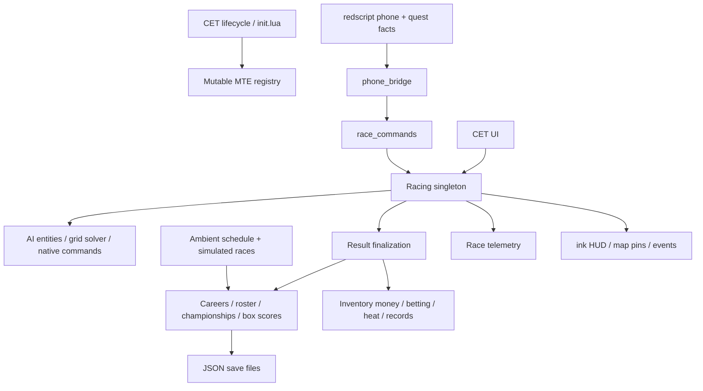

# NCM architecture

Date: 2026-09-18. Completed static code assessment; gameplay not executed. See the research index for remaining runtime questions.

## Scope and source of truth

Working payload: `ncm-localized/bin/x64/plugins/cyber_engine_tweaks/mods/MT_Ecosystem/` (abbreviated **M/** below). `NCM_MASTER_PLAN.md` identifies this as the implementation target. `staging/checkpoint-03/extracted/28713/release2.0` is a release snapshot, not the development target. Root-level manual-transmission patches, installation records, recovery assets, and WolvenKit tools are adjacent work, not additional NCM modules. No Git metadata or existing AGENTS.md was found in the workspace inventory.

The captured [source inventory](evidence/ncm-source-inventory.json) contains 64 Lua files and 54,097 lines under M/. Native scripts/assets and JSON localization add further scope. Do not mistake the `init.lua` internal version `0.1.0` for the advertised 2.0 beta. Preserve these distinctions in bug reports.

## Execution and ownership

`M/init.lua:15` requires modules and constructs global `MTE` at line 92. This is a service registry of mutable singleton modules, not a dependency-injected domain core. `onInit` (346) initializes persistence/localization, telemetry/metrics/safety/tuning, careers, nodes/roots/records/routes, roster and named rivals, management, race and UI, settings/onboarding/ambient, AI, knockout, event listeners, championships, phone, and optional RadioOS bridge. Active-career roster loading includes seeded history/catch-up behavior.

`onUpdate` (648) polls lifecycle, returns outside an active game session, then updates telemetry, metrics, tuning, racing, race telemetry, knockout, map pins, ambient races, HUD, phone, optional radio. AI ticking is reached through racing, not a separate top-level init update call. `onDraw` delegates to CET UI. Shutdown (669) deliberately saves without engine entity/UI cleanup because engine teardown calls are hazardous.

Module-local tables own transient state; `Careers.active()` supplies one selected career and literal `player`/`V` identities occur in result processing. Multiple concurrent server races cannot share these singletons unchanged. `events.lua` dispatches synchronous local callbacks using `pcall`; it is neither a network bus nor a transaction boundary. Errors can allow subsequent listeners to execute after partial effects.

## Race execution path

`racing.lua`: `openConfig` (4098) -> draft validation/preview -> `confirmConfig` (4369) -> PRERACE (4538), deferred field/grid preparation, readiness and spawn gates -> optional `startQuali` (4648) / `endQuali` (4681) -> `startRace` (4704) -> COUNTDOWN -> RACING (`update`, 3930 onward) -> player finish/DNF -> finish resolver -> `_finalizeRace` (5564) -> RESULTS -> `closeResults` -> IDLE. CONFIG is an editable state. Abort/restart and session transitions reset additional transient state.

Qualifying times combine a player run with projected AI performance; `_sortFieldByQuali` orders the field. Standing/rolling starts, side-by-side placement, readiness/alignment, deferred spawning and optional player snapping are significant systems. Grid geometry lives in `grid_solver.lua`; entity formation and asynchronous readiness are in `ai_vehicles.lua`.

Sprint, drag and endurance/sequence paths live in Racing; knockout has its own lifecycle in `knockout.lua` and ordered elimination circuits. Do not treat every format as one identical checkpoint loop.

## Physical AI versus simulation

`ai_vehicles.lua` creates vehicle/NPC entities, resolves templates/records, mounts drivers using multiple backends, waits for stable world conditions, builds drive profiles, issues autonomous/chase/follow commands, handles launch, stalls, waypoints and cleanup. `issueAutonomousCommand` (4488) constructs `AIVehicleDriveToPointAutonomousCommand`; `dispatchVehicleCommand` (4428) tries vehicle events/init command and NPC controller. Successful Lua dispatch is not proof that an engine car successfully followed its course.

`Racing._computeAITime` (6059) is a separate projected performance system. Live standings, remembered observations, visible-field checks, ghost fallback, untracked estimates and DNF grace participate in finish resolution (1926 onward; 5115–5375). An online result must explicitly record provenance: physically observed, estimated, or simulated. Never silently substitute a projected result for a human finish.

## Route representation

`data/nodes.lua` combines node sources; curated/manual/user/fast-travel modules provide positions and metadata. Nodes include IDs, coordinates, region, headings and road/urban flags. `default_roots_pack.lua` contains named roots, endpoint IDs, optional ordered node IDs and `profileSettings`; `roots.lua` persists roots and directed/canonical lookup indexes. `data/tracks.lua` supplies named pair metadata. `data/circuits.lua` currently declares one full-city 12-checkpoint loop with knockout elimination metadata; user circuit storage is separate.

`routes.lua` owns the telemetry route registry. Its default `buildPolyline` (92) creates **two endpoint points**, a distance and thirds as sector boundaries. Those are not verified road geometry. `checkpoint.lua:isNear` uses planar distance (default 50m); its progress score adds completed checkpoints to distance-to-next and can fall while moving away, despite the comment calling it monotonic. `racing.lua` also has finish-line crossing and ordered sequence progression. Automatic conversion can preserve coordinates, IDs and metadata; endpoint-only roots still need course-authoring/validation for shortcut-resistant online races, especially stacked roads.

## Result side effects and integration risk

`_finalizeRace` computes hype/payout, credits `Game.AddToInventory`, resolves bets/bounties, finishes safety scoring, awards rep, submits records, updates heat/roster, records championship points/box score/career history, despawns AI, finalizes telemetry and emits `RaceFinished`. This is the key integration boundary, but currently interleaves domain rules, storage, UI and game effects.

**Potential product-contract discrepancy:** `eventSourceType == quick_race` gates rep/roster/season/history, but base payout, record submission and heat updates are outside that guard. Box-score publication also has only a career guard. The README calls Quick Race consequence-free. Verify with a targeted playtest before changing behavior; this assessment does not fix it.

## Persistence

`persistence.lua` reads/writes JSON below mod-relative `save\\`; nested paths may be flattened with `__`. Saves copy existing content to `.bak`, then overwrite directly. This is not atomic multi-file commit or a concurrent database. `load` tries backup after invalid nonempty JSON, but returns immediately for missing/empty primary content. `loadVersioned` supports module migration callbacks; migration failures are logged yet the returned document is stamped with the requested version. These are concrete review targets before online reuse.

Career structures hold garage, management, betting and championship state; roster has per-career persisted populations; ambient state has `version=1, byCareer`; routes and telemetry indexes are versioned stores. Heat/settings/records/safety/tuning also own stores. Save identity is independent of a server account; online account/season/race IDs need a deliberate schema.

## Incomplete onboarding versus active phone control

Native onboarding quest is a work in progress, not a shipped promise verified here. The legacy race quest bridge is disabled in init; that does not disable the active phone bridge. See root master plan, playtest and quest-spike notes. Published reuse permissions were verified externally and are summarized below; they are not inferred from the brief or replaced with an invented open-source license.

## Subsystem ownership and extension map

All paths below are relative to M/modules unless prefixed otherwise. These are executable call sites and exported functions, not a claim that every branch has been runtime-tested.

| Area | Implementation and actual connections | Owned state / extension implications |
|---|---|---|
| Career/progression | `careers.lua:create/select/awardRep/recordRace`; finalizer and prestige listeners | Selected career, rep/prestige, bounties, history; one player identity; migration invokes supporting career systems |
| Population | `roster.lua:loadForCareer/pickForRace/applyRaceResult/simulate`; loaded by init, selected by Racing, written after results | Seeded cached drivers, pace/consistency, personalities, tiers, momentum, availability and lifecycle; `simulate` allocates off-screen races across tiers and moves drivers between them |
| Named rivals | `named_rivals.lua:ensureForCareer`; init synchronizes active population | Links fictional identities to engine records; paired localization archive and TweakXL YAML; distinct from logical driver IDs |
| Championships | `championships.lua:startNewSeason/currentEvent/recordResult/driverStandings/factionStandings`; Racing uses current season | Schedule schema v2, career-owned season and faction points, configured rulesets, completed results; not a multi-account server league yet |
| Box scores | `championships.lua:recordBoxScore/getBoxScoresPage`; called by both live finalizer and ambient resolver | Common participant/result envelope supports stories beyond the player's own races; preserve sourceType, event IDs and finishMode |
| Ambient schedule | `ambient_races.lua:update` on five-second accumulator; game-clock schedule maintenance -> resolveEvent -> roster/management/box scores | Versioned by-career schedule, completion archive, promotion eligibility and manually staged live candidates; off-screen races do not require spawned vehicles |
| Management | `management.lua:signDriver/queueSignedDriverForNextEvent/claimQueuedDriverForEvent/onAmbientEventResolved` | Exactly one signed slot (`SLOT_COUNT=1`), pending simulate/spectate entry, earnings/result state inside career |
| Economy/bets | `betting.lua:armSingle/armStreak/armWinnerBet/onRaceCancelled/resolveRace`; phone commands and finalizer | Career book/slips, stake state, odds/risk and direct player-inventory money interactions; lacks online escrow transaction boundary |
| Heat/factions | `heat.lua:applyRaceResult`, roster field building; `data/factions.lua` and championship factions | Heat is a global JSON store, not career-scoped. Decay uses wall clock with game-day scaling despite game-time wording. Distinguish district pressure from faction season points |
| Hype | `hype.lua:scoreRace` invoked before payout | Result/context-derived payout multiplier and session noise; preserve formula only if online inputs are validated |
| Garage/parts | `parts.lua:ensureCareerState/installPart/purchasePart/getRaceFitForConfig/ensureRivalVehicleBuild`; result listeners award offers | Career garage inventory, installed instances/slots, procedural offers and rival builds; data tables define parts and slot profiles |
| Tuning | `tuning.lua:onVehicleEnter/_captureOriginals/_applyAll/_restoreOriginals`; update consumes dirty state and part effects | Vehicle profiles (max five), scratch setup and captured drive-model flats; writes TweakDB baselines multiplied by effective values. Native record changes are not network-instance tuning |
| Telemetry | `telemetry.lua:update`, vehicle enter/exit; shared Telemetry.state -> Metrics/Racing/UI | Speed/input/blackboard readings, normalized/estimated RPM and G/slip proxies. Includes Manual Transmission config integration and a machine-specific fallback path; not every signal is a physical measurement |
| Metrics/safety | `metrics.lua` derives session analytics/events; `safety_rating.lua` listens and tracks incidents/distance | Session history; separate Quick Race and career SR profiles, incident grouping, bounded gains/losses. Collision severity is not fault attribution |
| Race analytics | `race_telemetry.lua:beginSession/updateProgress/finalizeActive/abandonActive` -> persisted index/session files | Trace samples, route/session identity, timing stack, incidents and aggregate route summaries; retention and semantics need a public dictionary |
| SMS control | redscript journal UI -> quest facts `ncm_phone_cmd_seq/id/route` -> `phone_bridge.lua:update` -> `race_commands.lua:execute` -> response event | Local sequence/dedup/deferred response state; commands are application actions but presently read global active career/race |
| Narrative | `event_listeners.lua` RaceFinished calls FanEngine, Parts and ContactEvents; prestige listeners do likewise | Fan milestone/history reactions; contact archetypes/offer decisions and consequences; deterministic helpers coexist with global random use |
| Onboarding | `onboarding.lua:init/mark/shouldPrompt/unlockContact` and phone intro flow | Versioned milestones and contact unlocks; vocabulary for tutorial steps is not proof every quest step is wired |
| UI | `ui.lua` draws Overview/Racing/Routes/Championship/Telemetry/Metrics/Tuning/Garage/Settings with ui_* helpers | CET/ImGui advanced control panels; draw path can trigger vehicle-enter initialization if telemetry is stale, so not a pure view |
| Native presentation | `ink_hud.lua` queues redscript HUD events; `mappins.lua`; `MTEcosystemHUD.reds` native update/result/season widgets and map hooks | Native HUD exists beyond CET; `MTEJournalHandler.reds` is the large phone service; `MTERaceRuntime.reds`, `MTEMappins.reds`, quest navigation/spike files support native plumbing |
| Configuration | `settings.lua`, `ui_routes.lua`, root profileSettings | Global config -> per-root override -> field default; Native Settings interface, vehicle-pool overrides, units/clamps and experimental switches |
| Authoring | `user_nodes`, `manual_nodes`, `fast_travel_nodes`, `roots`, `knockout_circuits`, `event_definitions` | Console node helpers, pack import/export, route draft normalization, portable event/node snapshots; validate stable IDs and road elevations |
| Localization/voice | `i18n.lua`, `locales/*`, `voice_harness.lua`, VOICE_GUIDE | English fallback/reverse index, placeholder validation, voice scenario/bundle validation; voice harness is an authoring aid, not proof of generated audio integration |
| Optional integration | `radioos_bridge.lua` loaded with pcall; telemetry reads MT config | Keep optional adapters separate from racing rules and release dependency claims |

## Concrete storage catalogue

- `careers.json`: careers plus active selection; nested garage/season/management/narrative/book state is updated by owning modules.
- `roster_<seed>.json`, `roster_meta_<seed>.json`: population cache and history/catch-up metadata.
- `ambient_races.json`: v1 byCareer schedule and archives; `onboarding.json`: v1 profiles/milestones.
- `config.json`, `roots.json`, user-node and custom circuit stores: configuration and author content.
- `records.json`, `heat.json`, `safety_rating.json`, `sessions.json`: independent statistics/world/session stores.
- `tuning_<sanitized vehicle key>.json`: per-vehicle saved tuning profiles.
- `telemetry\\routes.json`, `telemetry\\session_index.json`, per-session JSON: identity and detailed race analytics; persistence may flatten separators in actual filenames.

Do not migrate by copying all these files into a shared server namespace. First identify scope (server, season, account, vehicle, route revision, race) and preserve backups. Game save facts and mod JSON can diverge across save reloads; they are different persistence mechanisms.

## Dependencies and workbench separation

Code binds CET lifecycle/ImGui/Game/TweakDB; redscript classes and events; Codeware-style dynamic entities; Native Settings; native map markers; ArchiveXL/localization/journal and TweakXL rival records. The payload README lists CET, RED4ext, redscript, ArchiveXL, TweakXL, Codeware, Native Settings, Input Loader and Custom Map Markers. Treat this as the local installation contract, not a verified minimal dependency set. Published requirements differ (see audit); pin supported versions through release testing. Manual Transmission and RadioOS are integrations, not reasons to bring the whole personal mod stack online.

Recovered journal sources are under `wolvenkit-projects/mt_ecosystem`; recovery/reference folders document previous asset investigations. Root master plan contains historical statements later superseded by recovery work: read its current status/decision entries together with `NCM_QUEST_SPIKE.md`, not an isolated old paragraph.

Native script paths are `ncm-localized/r6/scripts/MT_Ecosystem/{MTEJournalHandler,MTERaceRuntime,MTEcosystemHUD,MTEMappins,MTEQuestNav,MTEQuestSpike}.reds`; named-rival tweak data is `ncm-localized/r6/tweaks/MT_Ecosystem/mt_ecosystem_named_rivals.yaml`. These are separate from the 64-file Lua hash inventory.

## Technical debt / incomplete-path register

1. Mutable global state and literal one-player identity; large orchestration modules mix effects and decisions.
2. Multiple independent result writes and tolerant pcall chains can leave partial progression; no durable finalization transaction or replay ledger found in the inspected race path.
3. Estimated/live result blending and endpoint-derived route telemetry require explicit provenance and route revisioning online.
4. Quick Race consequence contract discrepancy described above; do not advertise isolation until verified.
5. JSON overwrite/backup/migration edge cases; heat scope and clock semantics differ from some comments.
6. Grid spawning/mounting/pathing has many engine-specific fallback branches. Preserve diagnostics, but replace these branches when a verified network primitive owns lifecycle.
7. Reserved ambient radius settings are exposed in `settings.lua:377/381`; source permits live promotion but rejects knockout in the promotion path. One management slot and one bundled circuit limit claims.
8. Old quest probe disabled; new onboarding state/quest spike incomplete. Disabled code is not proven dead code; no destructive dead-code removal recommended from static search alone.
9. Version label drift; machine-specific telemetry fallback; UI can initialize gameplay state during draw.
10. No gameplay regression harness identified in inventory; localization tooling and manual playtest instructions exist. Static inspection cannot certify race reliability or unused branches.

## Published permissions verified

[NCM Nexus page](https://www.nexusmods.com/cyberpunk2077/mods/28713), checked 2026-09-18, identifies evengineer1ng as creator and ghohsty as uploader. Author notes state: **“Attribution is required for any derivative work.”** They request clear NCM credit on published project/mod pages. The permission panel permits credited modifications and conversions, credited asset use, commercial asset use and donation points, but prohibits uploading the original file to other sites. This is a custom Nexus permission statement, not an identified MIT/BSD license. Resolve the original-upload restriction versus automatic server redistribution before shipping a package; do not infer that third-party dependencies or separately derived assets inherit these permissions.

Status: architecture/subsystem assessment complete at static-analysis depth. Outstanding gameplay proofs are recorded as experiments; no production modifications made.
