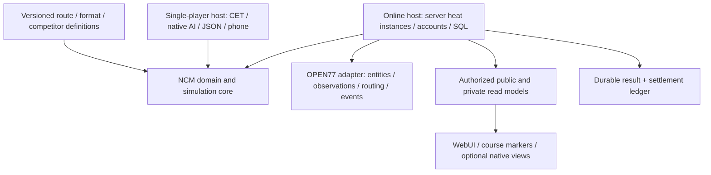

# Architecture options

Date: 2026-09-18. **Decision proposal, not implementation authorization or a validated design.** Grounding: [current NCM](NCM_ARCHITECTURE.md), [OPEN//77 evidence](OPEN77_RECON.md), [capability matrix](OPEN77_NCM_MATRIX.md). The product opportunity is a server racing/league framework, not merely network opponents in the author's solo career.

## Constraints every option must satisfy

1. Preserve the working single-player release and its independent roadmap. Use an isolated online prototype; do not replace production modules during reconnaissance.
2. Server decisions govern heat membership, ordered progress, result settlement, inventory and private state. Physics remains client-simulated under the inspected OPEN//77 model; none of these architectures makes cheating impossible.
3. Use durable account/competitor/season/race/route-revision identities. A client session ID, native entity handle or literal `player` is not a durable key.
4. Publish results once after durable acceptance; give all downstream side effects idempotency keys. Separate human physical results from fictional simulations.
5. Replace unsupported platform effects instead of emulating every CET/Game/TweakDB API. Isolate preview-dependent calls so churn has a small blast radius.
6. Human-only, physically observed AI and statistical simulation are distinct backend capabilities. Do not make a useful league service contingent on physical AI parity.

## A. Thin OPEN//77 adapter around substantial existing NCM logic

The adapter supplies identity, clocks, storage, entity operations and UI/network facades to largely unchanged NCM modules. A server owns the adapted orchestrator; online clients display snapshots and submit intents.

**Useful scope:** a narrowly scoped offline/one-heat prototype, route exporter, or selected simulation helper. NCM's data and arithmetic helpers are plausible reuse candidates. Its runtime is not a clean plug-in host: `racing` interleaves direct effects, active-career access, global MTE, local entities and result writes. A broad shim for `Game`, `TweakDB`, CET and native quest facts would become a second engine adapter rather than remain thin.

Cost appears low for the first demonstration but rises sharply for multiple heats, asynchronous storage and per-account narrative. Reuse could initially be high by line count while preserving the wrong boundaries. One isolated VM/resource per race might hide singleton conflicts but makes shared season/economy ownership and cross-resource lifecycle harder; it does not resolve transaction or trust problems.

Security requires extracting result authority regardless of reuse. Existing inventory writes cannot be permitted client-side. JSON save interception cannot provide a reliable multi-ledger transaction without changing callers. OPEN//77 APIs should replace native spawning, but existing AI fallback branches frequently assume local engine access, undermining a thin adapter.

Single-player can remain unchanged if the adapter is a separate copy, at the cost of divergent fixes. Server-owner extension is constrained by hidden globals and internal event order. Preview churn may spread through shims with ambiguous semantics.

**Stop condition:** if a minimal heat requires pretending unavailable native behavior exists, mutating global active career per entrant, or intercepting partial saves to infer settlement, reject A as the production architecture. Do not invest in general-purpose CET emulation.

## B. Shared NCM domain/simulation core with SP and OPEN//77 adapters

Extract useful deterministic functions and explicitly owned state incrementally: driver population/selection, schedule/standings, build eligibility, simulated results, progression policy and box-score construction. Inject RNG, time, identities and configuration. Return decisions/effects rather than calling native APIs or saving mid-rule. SP and online adapters apply those effects through their own stores and presentation.

The online host remains server-native; this does **not** mean sharing the entire current race loop or AI controller. A sensible first extraction is a pure standings/result-envelope slice, not the largest module. Use frozen fixtures from current behavior to detect unintended scoring changes; revise formulas intentionally where current semantics are unsuitable.

Initial cost is medium-to-high: tests, identity separation and effect boundaries are real work. Long-term maintenance improves when shared rules benefit both editions, but careless abstractions could slow SP work. Keep adapters independent and share only code that proves useful in two contexts. Lua loading differs: package the pure files for CET require and ordered server manifest loading without introducing server require assumptions.

SQL owns online account/results/escrow; SP JSON stays supported. Client commands enter validated application services; server emits sanitized read models. An outbox or equivalent durable pending-publication record lets box-score/notification delivery recover after a commit. Do not require exactly-once network delivery; require idempotent state effects.

AI backends become capabilities: native SP physical AI, OPEN//77 physical AI if experiments pass, and server statistical simulation. Same fictional identity can participate in different modes, with rules distinguishing record eligibility. Server-owner APIs register formats, packs and policies through validated contracts; extension callbacks cannot directly dictate payouts or bypass result acceptance.

Preview churn is concentrated in the platform adapter and observed-state schema. Shared domain code need not know vehicle IDs or API method names. Concurrency remains explicit in online orchestration; a shared core alone does not solve it.

**Failure risk:** extracting too broadly before product proof, or smuggling MTE/Game calls into the nominal core. Adopt B only if a bounded E12 slice demonstrates cleaner ownership and useful reuse without SP regression.

## C. OPEN//77-native edition preserving NCM concepts/data

Build a new server resource around network heat instances, durable identities and explicit services. Reuse licensed route/driver/part data where sound, and reimplement desired NCM rules from the documented behavior. Keep SP implementation separate.

This has high initial feature-delivery cost but avoids recreating a single-player environment. A focused human-only event kernel could arrive sooner than a full extraction, while parity with NCM's mature ecosystem would take substantial work. No timeline is credible before experiments establish scope.

Server-native ownership simplifies lifecycle, authorization and persistence design. It does not remove the need to harden checkpoint observations, implement idempotent settlements, or test physics ownership. Network AI limitations are identical to A/B. Human-only racing plus statistical fictional leagues remains a useful initial product.

Single-player stays protected; ongoing rule changes must be deliberately shared as specifications/fixtures or maintained twice. This option can simplify code but lose subtle mature behavior in roster evolution, narrative, build matching and finish recovery. A written compatibility target prevents accidental feature amnesia without demanding exact behavioral parity.

Preview calls still belong behind a small adapter; writing an entire resource directly against unstable APIs magnifies churn. Server-owner extension contracts can be designed cleanly from day one, but avoid publishing an API before one real extension demonstrates it.

**Choose C when:** extraction repeatedly exposes engine-coupled invariants, desired online rules differ materially, or maintaining a shared domain layer costs more than preserving tested specifications/data. Do not choose it merely because the platform is newer.

## Comparison

| Dimension | A: thin adapter | B: shared domain | C: native edition |
|---|---|---|---|
| First narrow demo | Potentially cheapest | Moderate setup | Moderate for a small online kernel |
| Complete ecosystem delivery | Hidden high cost | High initial, staged reuse | High reimplementation cost |
| Meaningful reuse | High superficial reuse, coupling risk | Selective rules/data reuse | Concepts/data/fixtures chiefly |
| Multi-heat/accounts | Awkward singleton workaround | Explicit online services | Natural explicit design |
| Security | Existing effects are dangerous seams | Central command/settlement boundaries | Clean boundaries if designed correctly |
| Persistence | Save-shim pressure | Separate SP store and online transactions | Native online schema |
| Physical AI | Native branches mostly replaced anyway | Backend boundary | Platform backend |
| SP preservation | Copy divergence or risky shims | Staged extraction with regression proof | Strong implementation isolation |
| API churn | Can infect compatibility layer | Concentrated adapter | Low only if adapters retained |
| Server-owner extension | Internal hooks fragile | Versioned domain/service contracts | Clean but initially unproven contracts |
| Maintenance risk | Accumulating emulation debt | Over-abstraction and dual-host tests | Feature/rule divergence |

## A useful intermediate product, not a fourth full port

An NCM league/results service could initially consume a hardened race executor and provide calendars, fictional competitors, standings and box scores. That executor might be independently written or a license-compatible extension of official Race. Current Race is a singleton Freeroam submode, so stable external result hooks and concurrency are not assumed. Its noncommercial license requires review before deriving/distributing code; NCM permissions do not override it.

This approach tests NCM's distinctive value with a smaller physical-racing scope. It becomes B if useful domain code is shared, or C if the online service is independently implemented. It must not let an untrusted resource submit arbitrary winning results; identify trusted executors and validate finalization contracts.

## Recommendation and migration sequence

**Provisional preference: B for league/simulation rules, with an OPEN//77-native race host.** This preserves useful mature behavior while replacing incompatible ownership and effects. A is appropriate only for bounded probes/helpers. C remains a credible fallback after measured extraction cost, not a failure of loyalty to old code.

1. Review reconnaissance and P0 documentation discrepancies; freeze a reproducible SP baseline and back up saves.
2. Run E0–E3 plus E7 in a separate prototype. Prove one explicit course, two humans, reliable cleanup and one durable result before adding career depth.
3. Run E4–E6 and E9 as scope gates. If AI/tuning fail, explicitly narrow the edition rather than simulate missing physical capabilities dishonestly.
4. Run E12: extract one standings/box-score slice with injected identity/time and compare fixtures. Decide B versus C from effort and clarity.
5. Add roster/calendar/off-screen results, then progression and narrative read models. Add betting only after result/ledger abuse tests.
6. Return proven domain extractions to SP one at a time with its existing playtest gates. Online work must not stall the author's solo product.

No schema migration, framework API promise or major port should begin until this assessment is reviewed. The next action is proof gathering, not a whole-project refactor.

Status: three architectures compared; provisional direction and rejection criteria recorded. Main unresolved decisions: physical AI quality, tuning scope, extraction payoff, licensing/distribution, and required competitive integrity level.
